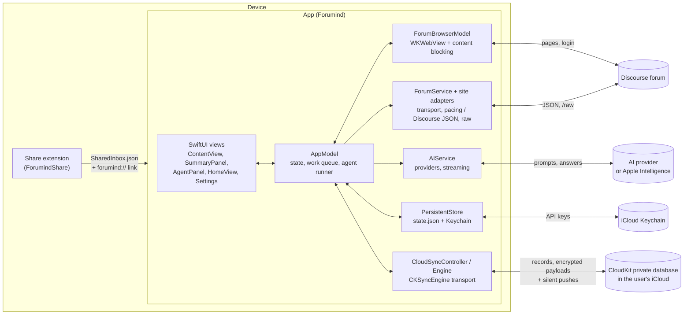
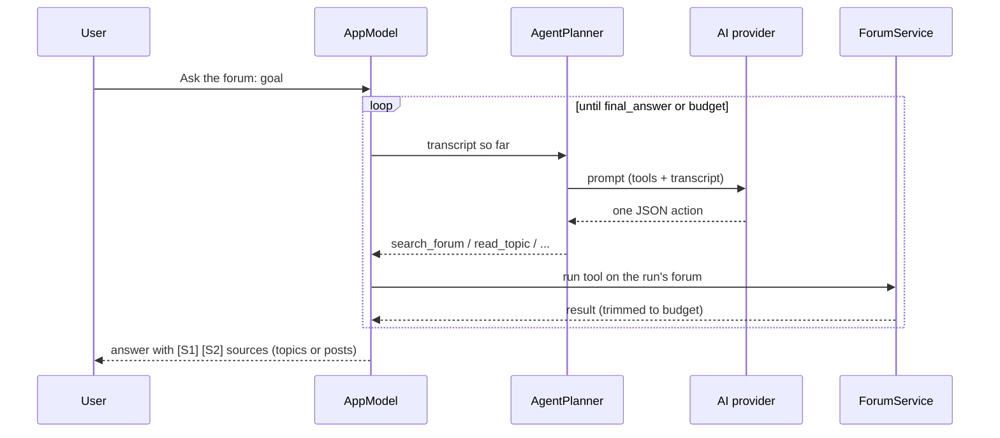
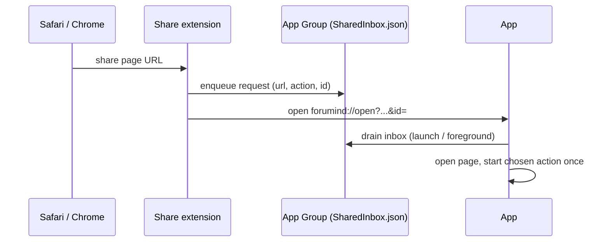

# Architecture

Forumind is a SwiftUI app with a `WKWebView` browser and an AI
assistant beside it, plus a share extension. It has no third-party
dependencies and no backend: the app talks directly to the forum and to the AI
provider the user chose.

## Module map

All app code is in `Forumind/`; files are grouped here by role.

### App shell and layout

| File | Role |
| --- | --- |
| `ForumindApp.swift` | App entry, `AppDelegate` (background refresh, notifications), scene setup. |
| `ContentView.swift` | Root view: browser, Assistant panel, Browse/Assistant switch, sheets. |
| `WorkspaceLayout.swift` | Side-by-side layout on wide windows (iPad landscape, large Stage Manager windows), resizable panel, keyboard commands. Narrow windows get a Browse / Assistant switch. |
| `DesignSystem.swift`, `ForumComponents.swift`, `AssistantStates.swift`, `MarkdownView.swift` | Shared styles, forum rows/tiles/switcher, Assistant empty/loading/not-a-forum states, and a small Markdown renderer. |

### Browser and forum identity

| File | Role |
| --- | --- |
| `ForumBrowser.swift` | `ForumBrowserModel` owns the `WKWebView`: navigation, the address bar, in-page probing, cookie handling, and attaching content-blocking rules. |
| `PageContext.swift` | What the Assistant knows about the current page. After each navigation (and single-page route change) an in-page probe collects the facts the registered recognizers declared; the registry's recognizers turn them into `PageContext.site` (a `SiteKind?`, nil for a plain page), and the page settles into `loading`, `notForum`, `maybe`, `forumHome`, or `topic`. On a topic it also says where the reader is: the post in the URL, the posts on screen and highlighted, and (once fetched) the post count and accepted answer. |
| `ForumSite.swift` | Forum identity, independent of the platform. A forum is its site URL: origin plus an optional base path for subfolder installs; https only (http for localhost). A topic key is `host[/basePath]/t/{id}`, unique across forums (the format is generic, not a Discourse route). Per-host cookie filtering lives here; the platform's URLs live in each adapter's `links`. |
| `ForumDirectory.swift` | Pinned and recent forums, and "Add forum" address validation through the adapter. A `Forum` stores its `kind` (`SiteKind`, synced). Suggested forums are declared by each adapter (`SiteAdapter.suggestedForums`). |
| `HomeView.swift`, `HomeState.swift` | Home (the Today module, Continue reading, pinned forums, Watching, Recent, suggestions) and the pages pushed over it; the Today module's states and the launch rule (where the app opens). |
| `ForumService.swift` | The transport only: one paced, retried GET per call (`data(_:accept:context:)`) with `Retry-After` handling, the in-page loader and the redirect guard. It knows no platform; adapters reach it through `SiteNetwork`. |
| `ForumRequestPacing.swift` | `ForumRequestPace` (the setting) and `ForumRequestPacer`, which spaces out every forum request per host; its clock is injectable for tests. |

**Forum identity and detection.** A `Forum` carries its `kind`; a job resolves
`SiteRegistry.adapter(for:)` when it starts and fails explicitly when there is
none. A page is recognized from facts, not from Discourse code in the browser:
each recognizer declares the page facts it needs (`PageFactKeys`: meta tags,
link rels, element datasets, selectors), the registry sends the union to one
generic probe (`PageFactsProbe`), and the route observer posts `{url, title,
facts}` once per document (again only when an `html`/`body` class changes,
because signed-in state lives there). `SiteRecognizer.recognize(facts:url:)`
returns a `SitePageMatch` (site URL, base path, name, topic, post), the first
recognizer in registry order wins, and `PageContext.site` keeps the kind. A
host a platform claims whatever the path (`claimedSiteURL(forHost:)`) is
checked first. Before the probe reports, the URL alone gives the topic
(`topicID(fromURL:)`, `looseTopicID(in:)`). Signed-in state and username come
from the same facts through the adapter's `session`. The share extension uses
the same recognizers and a probe script generated from them (see Share
extension).

**Site adapters.** Everything that knows a platform lives in `Forumind/Sites/`
behind one protocol, `SiteAdapter`. Discourse and WordPress are the adapters
today, in that recognition order.
Contributors adding a platform: [ADDING_A_SITE.md](ADDING_A_SITE.md).

| File | Role |
| --- | --- |
| `Sites/Recognition/SiteKind.swift` | `SiteKind`, the stable id of a platform (a struct wrapping a string, so a new platform adds a value, not a case in every switch). Stored on `Forum` and synced. |
| `Sites/SiteAdapter.swift` | `SiteAdapter` (a value of pure functions plus network calls through `SiteNetwork`; no state), `SiteLinks` (pure URL building and parsing), `TopicRef`, `TopicReadRequest`, `SiteQuery`/`SiteQueryResult`, `AgentToolName` and `AgentSiteProfile`. |
| `Sites/SiteCapabilities.swift` | `SiteCapabilities`: the optional abilities, each present and working or nil (active topics, post lookup, topic filters, page bridge, login and search page URLs, session reader, first-party path patterns). |
| `Sites/SiteRegistry.swift` | `SiteRegistry`: the adapters in this build, in recognition order. Lookup by kind, recognition, the union of declared fact keys and first-party patterns, the voice setup. `adapterFactories` pairs each kind with its adapter. |
| `Sites/Recognition/` | What the share extension also compiles, so nothing here may use an adapter or the network: `SiteRecognizer`, `SiteRecognizers.standard` (the one list of platforms), `PageFacts`/`PageFactKeys`, `PageFactsProbe` (builds the probe script), `DiscourseRecognizer`, `WordPressRecognizer`. |
| `Sites/SiteNetwork.swift` | `SiteNetwork` (transport plus `SiteRequestContext`, scoped to one site; a URL outside the site is refused) and the context (cookies, in-page loader, pace) gathered once per job. |
| `Sites/Shared/` | Code every adapter may use: `RawTopicFormat` (the one shape of a topic's AI-facing text), `PostBlock`, `PagedTopicFetch` (the paced page loop), `TopicFacts`. |
| `Sites/Discourse/` | The Discourse adapter: `DiscourseAdapter`, `DiscourseAPI` (requests), `DiscourseRoutes` (URLs), `DiscourseParsing`, `DiscoursePagePlan` (which raw pages to fetch), `DiscourseDOM` (the in-page bridge and moderation scripts), `DiscourseAgent` (tool specs, voice words), `DiscourseSuggestions`. |
| `Sites/WordPress/` | The WordPress adapter, a second worked example: `WordPressAdapter`, `WordPressAPI` (REST requests; paging read from `X-WP-Total` headers, closed comments and pages past the last read as empty), `WordPressLinks` (`/?p=ID`), `WordPressParsing` (article and comments into `RawTopicFormat`), `WordPressPagePlan`, `WordPressTools` (post and comment search, latest, post lookup), `WordPressActiveTopics` (digest: newest posts and recent comments), `WordPressAgent` (tool specs, voice and discussion profiles). It has no page bridge, sign-in page or session reader, so the app never scripts a WordPress page and navigates by URL. |

**Layering.** Only `Forumind/Sites/` may name a platform.
`scripts/ci/check-site-layering.sh` fails when Swift code outside it mentions a
Discourse type, `SiteKind.discourse` or a `/t/` route. The remaining hits are
listed in `scripts/ci/site-layering-allowlist.txt` (sample data, UI-test seeds,
the share sheet's badge, the generic topic-key format); the list may only
shrink, and an entry that no longer matches fails the check too.

**Forum requests.** When the web view is showing the same forum, JSON and raw
requests run as `fetch()` inside that page, so the forum login and any
Cloudflare clearance are reused. Otherwise (another page is open, or a
background refresh) they go through `URLSession` with that forum's cookies
only; a redirect to another origin is followed without them
(`ForumRedirectGuard`).

**Pacing.** Every request `ForumService` makes (topic JSON, each raw page,
search, latest, site info; on both paths) first takes a slot from the
shared `ForumRequestPacer`. Pacing is per forum host, so forums never slow
each other down, and first come first served across all work on that forum
(summaries, chats, agent tools, watch checks). The pace is a synced setting,
`AppSettings.forumRequestPace` (Settings › Summaries & chat › Forum requests):

| Pace | Starts at most | In flight at once |
| --- | --- | --- |
| Gentle (default) | 1 per second | 1 |
| Standard | 2 per second | 2 |
| Fast | no limit | 4 (the behavior before pacing) |

So at Gentle a 2,000-post topic (20 pages of 100 posts) takes about 20
seconds; pages already cached (`CachePlan`) are neither requested nor paced.
A `429` gives the slot back and pushes that host's next start back by
`Retry-After` (or an exponential backoff), on top of the pace. A job captures
its pace in `RunSettings` when it starts. Waits are `Task.sleep`s, so
cancelling a job stops it at once, before its next request and without
writing anything back. Fetch progress is reported before the first paced page
and after every page, so the bar and status keep moving during long reads.

### App state, work queue, and settings

| File | Role |
| --- | --- |
| `AppModel.swift` | The main-actor `AppModel`: published state, the work queue, summaries, chats, watched topics, persistence hooks. |
| `AppModel+Models.swift` | Model roles: `ModelRole`, `ModelScope`, per-role readiness and selection, favorites, and the rule that keeps `selectedProvider` on the assistant role for older builds. |
| `AppModel+Assistant.swift`, `+Browse.swift`, `+Onboarding.swift`, `+ContentBlocking.swift`, `+CloudSync.swift`, `+StateDebug.swift` | Feature slices of `AppModel` (and their DEBUG launch arguments). |
| `Models.swift` | Codable models: `AppSettings`, `TopicSession`, `AgentRun`, `WatchedTopic`, `WorkRecord`, provider configuration, `ModelSelection`. |
| `WatchSupport.swift` | Local notifications (watched topics, the daily digest) and the Background App Refresh task for watched topics. |
| `DailyDigest.swift`, `AppModel+Digest.swift`, `DigestViews.swift` | The daily digest: cards, planning, the prefetch and its background task, storage; making the cards; the Today page and Settings › Daily digest. |
| `AppModel+System.swift`, `System/*.swift` | System entry points: App Intents and Siri phrases, Spotlight, Siri suggestions (see below). |
| `Translation/*.swift` | On-device translation: the reading language, the Translate button and sheet (see below). |
| `Podcast/*.swift`, `PodcastViews.swift` | The podcast: settings and consent, the script and its checks, Gemini TTS and on-device speech, the episode cache, the player with Now Playing, the controller (making, Ask about this, read aloud); the Today page's mini player and chapter list, the consent sheet, the read-aloud button. |

**Work queue.** Summaries, chats, and agent runs are `WorkRecord`s. Two run at
once (`TaskLimiter`), with per-topic ordering, up to 50 queued, progress and
cancellation, and restore after relaunch. Finished activity is kept for 24
hours. Removing a forum together with its data cancels its work first.
Cancelling frees a job's worker slot at once. When the app leaves the
foreground, running work goes on for the background time the system gives;
when it runs out (or a request fails because the app is in the background)
the work goes back in the queue as paused, keeping the pages it read, and
starts again when the app is active. Forum requests retry dropped
connections and gateway errors; work the app starts by itself (a watched
topic's refresh) reports failures in Manage without an alert.

**RunSettings.** Settings edits apply immediately to work that hasn't started;
work that is already running keeps a snapshot (`RunSettings`) of the provider,
model, prompts, limits, and forum request pace it started with. Deleting a key, switching
provider, or a synced settings change from another device never changes a run
midway.

**Model roles.** Two defaults, each a provider and a model: the
**assistant model** (`AppSettings.assistantModel`) runs summaries, chat,
watched-topic refreshes, and the agent's `summarize_topic` tool (bulk
summarizing on the low-cost model); the **agent model** (`agentModel`) runs
Ask the forum's planning, answers, and follow-ups. `RunSettings` captures
both when a job starts (`configuration` is the job's own model, `summarizer`
the assistant model). Keys and base URLs stay per provider, shared by both
roles; favorites are provider + model pairs shared by both. Readiness is per
role (`isProviderReady(for:)`): the Assistant's setup card, the header's model
switcher, and share hand-offs use the role of the mode they're in.

| Work | Role |
| --- | --- |
| Summary, check for new replies, chat, watched-topic auto-refresh | assistant |
| Ask the forum: each planning step, final answer, follow-ups | agent |
| Ask the forum's `summarize_topic` tool | assistant (if it isn't ready, the step fails and the agent can read the topic instead) |
| Pull post + replies | no AI (recorded with the assistant model) |

**Summaries.** Discussions longer than the batch limit (default 55k
characters, 20k–1M in Settings; long-press the summary button to pick a size
for one run) are split into batches. Each batch is summarized, the batch
summaries are folded again while they still exceed the limit, and the result
becomes the final summary. **Check for new replies** reads only the new pages.
With the app in English, summaries follow the discussion's language and chat
and agent answers follow the user's; with the app in another language
(Simplified or Traditional Chinese), answers default to the app's language
(`PromptBuilder.discussionLanguageInstruction`). Prompts are always English.

**Localization.** UI strings live in String Catalogs
(`Localizable.xcstrings`, `InfoPlist.xcstrings` in each target), in English,
Simplified Chinese and Traditional Chinese; iOS picks the language
(Settings › Forumind › Language). `AppLanguage.swift` reports the resolved
language. See [DEVELOPMENT.md](DEVELOPMENT.md#localization).

**Watched topics** are checked when the app comes to the foreground, every 30
minutes while it's open, and by a best-effort Background App Refresh task. New
replies post a local notification, mark the saved summary stale, and
optionally queue a refresh. Each topic is one paced request; topics checked
longest ago go first, and a background check stops after about 20 seconds
(`backgroundWatchCheckBudget`), so the rest go first next time.

**Daily digest.** A Today page with one card per topic: watched topics with
new replies since the last digest (most new replies first), then the day's
top topics of the pinned forums (`/top.json?period=daily`, else
`/latest.json`; the forums take turns, pinned announcements are skipped).
A topic appears once, and the digest has at most 8 cards (3–20 in
Settings). Each card shows the forum, why it is there ("5 new replies",
"Trending"), a two-to-three sentence summary, and links that open the topic
at the first new reply, the accepted answer, or the most liked reply
(`?filter=summary` for long topics when that isn't known).

| Step | When | What runs |
| --- | --- | --- |
| Prefetch | A `BGProcessingTask` (`<prefix>.digestPrefetch`, needs network and external power, from 4:00), only while the daily digest is on; or on open when no fresh prefetch exists | Forum JSON only: each pinned forum's list (up to 8 forums), then the topic JSON of the planned cards, watched topics first. At most 24 requests, at the gentle pace in the background, saved after each request. No AI. |
| Notification | After a background prefetch that found topics, if turned on, once a day | "Today's digest is ready to make"; tapping it opens the Today page. |
| Cards | Opening the Today page, or the app coming to the foreground with the daily digest on, while today's digest is missing or unfinished | One card at a time with the assistant model (`RunSettings` taken when the run starts), through the summary pipeline (`generateSummary` with the digest's instructions, so batching and the Apple Intelligence budgets apply). |

A card's text comes from the cheapest source: an earlier digest's card for
the same post count (no AI), the saved summary condensed when it covers every
post (the topic isn't read again), or the topic read (cached pages reused;
the beginning and newest replies kept within the context limit) and
summarized. Every card's state (waiting, working, done, failed) is saved, so
going to the background (the run pauses) or a kill continues from the same
card. Offline, the card goes back to waiting and the page says so; a card
that fails shows its error and can be retried, and nothing raises an alert.
Without a ready assistant model nothing starts and the page offers setup.

The digest is off by default, because making it spends the user's credits;
the Today page always offers **Make Today's Digest**. On/off and the
notification are device-local settings (each device spends and schedules
on its own); what goes in and the card cap sync. The last 7 digests and the
prefetch live in `digests.json` next to the snapshot, on the device only
(not in iCloud sync); they can be deleted in Settings › Daily digest or from
the Today page, and a forum's cards go with its data.

The Today module sits at the top of Home, and the Today page is pushed over
Home (`AppModel.homePath`: the iPhone bar's navigation stack, or Home's own
on iPad); opening a link closes both and shows the browser.

**Launch.** Settings › Browser › When Forumind opens: Automatic (default),
Home or Last forum. A link, notification, Siri, Spotlight or the share
extension always opens its page. Automatic shows Home on the first launch of
the day when Today has a podcast or digest ready or being made (the day is
kept in UserDefaults on the device), and otherwise the last forum.

### AI providers

| File | Role |
| --- | --- |
| `AIService.swift` | Streaming chat/completion calls for every provider: OpenAI-compatible APIs (OpenAI, OpenRouter, Groq, xAI, DeepSeek, NVIDIA NIM, LM Studio), Anthropic, Google Gemini and Google Vertex AI (same streaming format; Vertex AI takes the key in a header and has a built-in model list, so its "Test" counts tokens instead), and Ollama. Model listing and the "Test" check. |
| `PromptBuilder.swift` | System prompts, hierarchical batching, and chat context. |
| `SettingsProviderPage.swift`, `SettingsProviderForm.swift` | Settings › AI models (a model per role, each provider's key and address, favorites), the model picker, and the provider setup form used by onboarding and the "Connect an AI provider" sheet. |

Apple Intelligence (on-device and Private Cloud Compute) is a provider too;
see [APPLE_INTELLIGENCE.md](APPLE_INTELLIGENCE.md).

### Ask the forum (agent)

| File | Role |
| --- | --- |
| `AgentEngine.swift` | Tool specs, `AgentPlanner` / `PromptAgentPlanner`, and parsing of the model's actions. |
| `AgentPanel.swift` | The Ask the forum UI: goal, steps, answer with numbered sources, follow-ups. |

The agent is read-only. A run's tools are the site's own (`AgentSiteProfile.siteTools`,
specified by the run's adapter: Discourse offers `search_forum`, whose results
list each matching post as `#N @author`, and `list_latest`) followed by the
app's tools, the same on every site: `read_topic` (the text starts each post
with `author | date UTC | #N`), `summarize_topic`, `saved_summaries`,
`watch_topic`, and `final_answer`. Names are the `AgentToolName` enum, shared
by the model, the transcript and Apple Intelligence; adding one is an app
change, not an adapter's. `AgentPrompt.tools(for:)` builds the list for a
run and the prompt's words ("a Discourse forum", topic, how to cite a post)
come from the adapter's `AgentSiteProfile`. The profile also maps a site
tool's arguments to a typed `SiteQuery` (`search`, `latest`), which the
adapter runs; a tool outside the run's list throws
`AgentError.unknownTool(name, available:)`. Apple Intelligence keeps a
literal `@Guide(.anyOf…)` list of tool names (a macro cannot read a
registry); a test compares it with `SiteRegistry.allAgentToolNames`. The planner asks the model for one JSON
action per turn, so it works with every provider, including ones without
native tool calling. Each run belongs to one forum (`AgentRun.siteURL`): every
tool call and follow-up stays on it, topic ids from the model are reduced to
digits, and URLs are always built from the run's forum. Budgets (default 15
steps, 8 topic reads, 30k characters per read) are in Settings. Tools carry a
`requiresApproval` flag so a tool that writes to the forum would need the
user's confirmation. Topics the agent summarizes become ordinary saved
summaries.

**Sources.** The answer cites topics as `[title](url)` and single posts as
the topic URL plus the post number on Discourse (`AgentSources`, which
parses links through the run's adapter, so the equivalence of two links is the
adapter's). Links to different posts of one topic are
separate sources; a link to the whole topic reuses that topic's first source;
topics read but not cited follow at topic level. Tapping a post-level source
opens the topic at that post.

**Runs from code.** `startAgentRun(goal:siteURL:completion:)` and
`performAgentRun(goal:siteURL:)` queue a run like the panel does, without
changing the panel, the selected run or the draft, and hand back an
`AgentRunOutcome` (answer, sources, status) when it ends; `cancelAgentRun(id:)`
stops one. The voice agent's `research` tool is meant to use them.

### Post-level browsing

| File | Role |
| --- | --- |
| `BrowseBridge.swift` | The in-page bridge and its typed async calls on `ForumBrowserModel`. |
| `BrowseCursor.swift` | `BrowseItem`, `BrowseCursor` (the current list), `BrowseLanding`, `BrowseFocus`, `BrowseResult`, and text trimming. |
| `AppModel+Navigation.swift` | The navigation API: open, focus, find, next/previous, read, research, and the typed paths. |
| `ResultCards.swift` | The current list as numbered cards over the page. |

This layer moves the page to a single post. What it needs from a platform is a
capability of the adapter, present or nil: `pageBridge` (the in-page bridge and
moderation scripts, `DiscourseDOM` for Discourse), `topicFilters` (top posts,
one author), `postLookup` (post text by number from the API), `activeTopics`,
`loginURL`, `searchPageURL` and `session`. The app gates on the capability: with
no `pageBridge` no script is sent to the page, with no `topicFilters` the `top`
landing falls back to the topic and the voice agent loses its author modes,
with no login URL the forum menu hides Sign in. Nothing gates on a platform
flag for data the pages show (accepted answers, likes).

The description below names Discourse's selectors and URLs because that is the
adapter that exists; they live in `Sites/Discourse/`. The voice agent's tools (`find`,
`open`, `move`, `focus`, `read`, `research`) are meant to call it, and it
works without voice through the cards and post links.

**Bridge.** A third user script, next to the route observer and the
moderation script, runs in its own `WKContentWorld`, main frame only, and is
called with `callAsyncJavaScript` (2 s timeout; nil when the page is not a
topic). It uses the moderation script's selectors
(`article[id^="post_"]` in its `[data-post-number]` wrapper, `a[data-user-card]`,
`.cooked`) and its MutationObserver + `requestAnimationFrame` pattern:

- `scrollToPost(n)` puts a rendered post under Discourse's fixed header. A
  post that isn't rendered (Discourse cloaks far-off posts) makes the app
  load `/t/slug/id/N` instead, and Discourse lands on it.
- `highlight([n])` / `clearHighlight()` add a class with an injected style
  (a brand-blue bar and tint that read on light and dark themes). The
  observer puts it back when Discourse re-renders a post.
- `visible()` lists the posts actually in the viewport
  (`getBoundingClientRect`, minus the header and the cards).
- `postText(n)` returns a rendered post's plain text. Otherwise the app reads
  the post from `/t/{id}/posts.json`.

A post the moderation script hid (`data-forumind-hidden`; the DOM is shared
between worlds) is never scrolled to, highlighted or returned. The Swift side
checks the user's blocks and filters again on every hit, source and post text
it gets from the forum's JSON.

**Page position.** Discourse rewrites the URL to `/t/slug/id/N` while the
reader scrolls, so `PageContext.postNumber` comes from the route observer.
After scrolling settles (250 ms), the bridge posts the visible and
highlighted posts to a message handler registered in its own world, so page
scripts can't fake them. These position fields take a cheap path: AppModel
updates `pageContext` without selecting or saving the topic. Every change
also reaches `pageChanges`, debounced (400 ms), which the voice layer will
turn into silent notes. The topic's facts (post count, accepted answer) are
fetched once per topic when a navigation action needs them, or for every
topic when `prefetchesTopicFacts` is on (left for voice, so plain reading
costs no extra request).

**Navigation model.** AppModel and `browseCursor` own the state; nothing else
keeps a copy.

- `openTopic(_:at:)` lands on `.post(n)`, `.solution`, `.last`, `.top` (the
  top posts, `?filter=summary`) or `.firstNew`. `.firstNew` goes after a
  watched topic's known replies; otherwise it uses the plain topic URL,
  where Discourse puts a signed-in reader at their last-read post.
- The landing post stays highlighted until the next navigation (or until the
  reader leaves the topic). It is not timed: someone glancing back at an
  iPad on a stand should still see where they are. A full page load
  re-applies it.
- `focus(_:)` narrows the topic with Discourse's own `?username_filters=`
  (one author, or the opening poster) and `?filter=summary` views, or
  highlights a set of posts (a tour). The focused posts become the current
  list.
- The current list (`BrowseCursor`) holds search hits from `find(_:scope:)`
  (`topic:<id>` for the topic scope), research sources, or focused posts.
  `next()` and `previous()` move along it and stop at either end.
- `read(post:)` reads from the page first, then from `posts.json`.
- `back()` and `forward()` use the browser's history.
- `research(_:)` runs Ask the forum through `performAgentRun`, one at a time.
  A new request cancels the old one, and `cancelResearch()` stops it. When
  the answer comes back, the sources become the current list and the first
  one opens at its post. The agent itself never moves the page.
- Every action returns a Codable `BrowseResult`: a status, `shown` (for
  example "Post 37 of 120 by alice (accepted answer)"), `content` (the
  landing post's text, cut at a sentence near 3,000 characters, about 800
  tokens) and `hits`. The text is English because the model reads it.

**Cards.** `ResultCardsOverlay` sits in `BrowserContent`, where the crash
banner is, so it works the same on iPhone and iPad and can't cover the
browser bar, which is outside that view. It is a horizontal strip at the
bottom of the page, above the bottom bar, or above the home indicator when
the bar is on top. That keeps it clear of the post a jump lands on, which
sits at the top. Each numbered card shows the title, post number, author and
one line of text, and the current card is marked. The strip has
previous/next buttons and a close button, can be swiped down to dismiss, and
collapses to an "N results" chip. It also collapses while the bar is
minimized, because the reader is scrolling.

**Typed paths.** Without voice, links tapped in the assistant panel (answers
and sources) and on the Today page go through `openLink(_:)`. A post link
opens the topic at that post and highlights it. Tapping an Ask the forum
source also makes that run's sources the current list, so the cards and Next
follow them. Search keeps its own UI.

### Voice agent

| File | Role |
| --- | --- |
| `Voice/LiveProtocol.swift` | The Gemini Live wire format (setup, client frames, server messages) and the AI Studio and Vertex AI endpoints. |
| `Voice/LiveTransport.swift` | `LiveTransport`, and its WebSocket implementation (ordered sends, receive loop, ping, close codes). |
| `Voice/VoiceSession.swift` | The session: states, tool-response hold, scheduling, briefings, silent notes, resumption and refresh, stalls, watchdogs, idle close, minutes used. |
| `Voice/VoiceTools.swift` | The seven tools, defined once, with the Gemini adapter; declarations are built per site (`geminiDeclarations(for:)`). |
| `Voice/VoiceSite.swift` | `VoiceSiteProfile` (persona, search-word hint, language hint, the adapter's `voice`) and `VoiceSite` (the profile plus the focus modes the site supports: `user`/`op` only with `topicFilters`). `SiteRegistry.voiceSite(for:)` resolves it for the page's site, else the current forum's, else a fallback. A session fixes it when it connects (Gemini Live takes its declarations once). |
| `Voice/VoiceToolBridge.swift` | `VoiceNavigator`, the tools run on the navigation layer, research briefings, and routing in code. |
| `Voice/VoiceContext.swift` | The silent context: topic brief, position deltas, full post text, screen references. |
| `Voice/VoiceInstructions.swift` | The system instruction, in named parts. |
| `Voice/VoiceAudio.swift` | The audio boundary (`VoiceAudioIO`), the clock, comfort noise. |
| `Voice/VoiceAudioEngine.swift` | `VoiceAudioEngine`: capture with echo cancellation, playback, interruptions and route changes, the health snapshot. |
| `Voice/VoiceAudioFormat.swift` | The audio formats, `PCMConverter`, `FrameChunker`, `PCMLevel`. |
| `Voice/VoiceActivityDetector.swift` | `VADTuning`, `VoiceActivityDetector`, `CaptureGate`. |
| `Voice/PlaybackQueue.swift` | `PlaybackQueue` (jitter buffer), `PlaybackProfile`, `PlaybackRatePolicy` (time-stretch). |
| `Voice/VoiceAudioHealth.swift` | `VoiceAudioHealth`, `VoiceProcessingStatus`, `MicSignalWatchdog`, `SpeakingHold`. |
| `Voice/VoiceSettings.swift` | Voice settings, the voice list, consent, minutes per day. |
| `Voice/VoiceController.swift` | Starts and ends sessions for the UI: the microphone, the consent sheet, the bar. |
| `Voice/VoiceDebug.swift` | The typed-input switch and the scripted session for UI tests (`-dc-voice-fake`). |
| `VoiceViews.swift` | The browser-bar microphone, the consent sheet, the voice bar with its Health row, Settings › Voice. |
| `AppModel+Voice.swift` | AppModel as the navigator; the session's configuration and the consent gate. |

The voice agent talks to Gemini Live (`gemini-3.8-live`) directly from the
device with the user's own key: AI Studio with the Google Gemini key, or
Vertex AI with the Vertex key (`us-central1`, the full
`projects/…/publishers/google/models/…` model name; the project comes from
the Vertex address in Settings or from the voice settings). The key goes in
the `x-goog-api-key` header. Everything below is tested offline; the first
live sessions are run on a device by the owner.

**Tools.** `find`, `open`, `move`, `focus`, `read`, `research` and `end`, all
NON_BLOCKING (a BLOCKING call pauses the whole server stream). They call the
navigation layer above and turn its `BrowseResult` into a function
response: `status`, `shown`, `content`, `hits` and a `message` that tells
the model what to say next, for example to give the gist and not read the
post out, or, in eyes-free mode, that it may read it. Refusals say to tell
the user instead of retrying. A `research` request that is only a browser
command ("next", "post 37", "the solution") is done directly. Research
answers `started` at once, sends progress as silent briefings and the answer
as a WHEN_IDLE briefing; a new research replaces the old one.

**Session.** `VoiceSession` holds each function response until the
`turnComplete` after its call (at most 1.5 s), and downgrades INTERRUPT to
WHEN_IDLE while the model speaks or playback still has audio. Updates that
answer no call are function responses named `briefing` with made-up ids.
Silent notes (`clientContent`, `turnComplete: false`) go out only while both
sides are quiet. The whole context goes out again after every reconnect,
because what was sent after the last resumption handle is lost. AI Studio
gets one connection per session (close before resume) and a fresh,
re-seeded session at about 54 minutes. Vertex never resumes a resumed
session. A turn with no server message for 10 s recycles the connection.
Watchdogs nudge an unacknowledged research after 1.5 s, re-send a
result unspoken for 6 s, and cut off tool markup spoken as text. The session
closes after the idle timeout (60 s by default), and counts connected
minutes per session and per day on the device.

**Cost guard.** A per-session limit (15 minutes by default) and a daily
limit (30), each adjustable or off. At a limit the session ends at the next
quiet moment, after the current answer (at most a minute later), and the
bar says why; once today's minutes are used, a new session ends at once.

**Audio.** `VoiceAudioEngine` runs an `AVAudioEngine` with the session in
`.playAndRecord` / `.voiceChat` (Bluetooth HFP and A2DP, default to the
speaker, 40 ms IO buffer). Voice processing is turned on on the input node
before the engine starts, which makes the engine's I/O one voice-processing
unit; the player → `AVAudioUnitTimePitch` → main mixer chain is connected
in `start()` and plays through it, so the echo canceller hears what the
voice says. Both input mutes (the unit's and `AVAudioApplication`'s) are
cleared at start.

- Capture: the tap buffer (hardware format, usually 48 kHz Float32) is
  copied on the render thread and converted on the main actor to 16 kHz
  PCM16, cut into 40 ms frames and passed through `CaptureGate`. Its
  voice-activity detector measures the speech band against an adaptive
  noise floor and starts closed, so nothing is sent until the user speaks;
  the transition reaches the session before the frames (with 100 ms of
  pre-roll). `MicSignalWatchdog` flags a microphone that delivers digital
  zero for 3 s and rebuilds capture once.
- Playback: the model's 24 kHz chunks go through `PlaybackQueue`, an
  adaptive jitter buffer (150–500 ms for Gemini) that schedules them back to
  back on one player node. Every 20 ms it steers the time-pitch rate
  (0.85–1.05, pitch kept) from the buffered audio, and counts underruns.
  `isPlaying` covers buffering and a short hold across gaps (`SpeakingHold`),
  since it decides when INTERRUPT is downgraded.
- A route change, `AVAudioEngineConfigurationChange` or a media-services
  reset rebuilds the chain, restoring `.voiceChat` and voice processing (the
  reset also replaces the engine and its nodes). A call or Siri pauses and
  flushes; when iOS doesn't offer to resume, the bar shows "Tap to resume".
- With `audio` in `UIBackgroundModes` the audio and the connection keep
  going with the screen locked. Not yet tried on a device: the page position
  and, by default, forum requests come from the web view, which iOS suspends
  in the background, so tools that need the page may stall until the app is
  back.

**UI.** The microphone in the browser bar (both positions) shows while voice
is on, or while a Gemini or Vertex key is there and voice was never agreed
to. The first tap per provider opens the consent sheet. The voice bar sits
over the bottom of the page under the result cards, also over the Forums
home, and counts as covered page for the bridge. It shows the state, the
last transcript line, mute and end; tapping the state opens the Health row
(echo cancellation and what is missing, underruns and the buffer target,
the route, the microphone rate and level). The typed-input field ("type
instead of speak") sends `realtimeInput.text`; it is always there in DEBUG
builds and behind a developer switch (seven taps on Build in Settings ›
Help › About) otherwise.

**Silent context.** `VoiceContext` builds bracketed `[Screen: …]` and
`[Forumind: …]` notes: a topic brief when a topic opens (title, forum and its
language, the opening question, post count, solution, top posts, the saved
summary or a quick one made in the background), then position deltas from
`pageChanges` (current post, visible posts as author and first sentence, the
current list). When the user's words point at the screen ("this post",
"他说的"), or the reader stops on a post for about 2 s, the focused post's
full text is sent (both switchable). Posts are capped at about 800 tokens.

**Consent.** Before the first session with a provider, the user must agree
that audio and the page content they ask about go to Google (App Review
5.1.2). The consent, like "voice on", is kept per device; the voice
preferences sync. The session refuses to start without it.

### Podcast

| File | Role |
| --- | --- |
| `Podcast/PodcastSettings.swift` | Hosts (ids `A`/`B`, default names per language), voices, engine choice, length; the TTS consent; engine selection. |
| `Podcast/PodcastScript.swift` | Chapters, the fixed intro and outro, the chapter prompt, JSON parsing and the speech checks, the fallback chapter. |
| `Podcast/PodcastSpeech.swift` | The speech-engine protocol, the Gemini TTS request, response decoding (WAV or L16), WAV reading and writing, retries. |
| `Podcast/PodcastSystemSpeech.swift` | `AVSpeechSynthesizer` written to a file; picking two system voices. |
| `Podcast/PodcastStore.swift` | Episodes and their files in `Caches/Podcasts/<digest id>/`, cleanup. |
| `Podcast/PodcastPlayer.swift` | The timeline, the player, interruptions and route changes, the hand-over to voice, positions, Now Playing and remote commands. |
| `Podcast/PodcastController.swift` | Making episodes, Ask about this, read aloud, cleanup (`app.podcast`). |

A finished digest can be heard as a two-host episode, "Today on Forumind –
<date>". It has a fixed intro and outro in the interface language (no AI)
and one chapter per summarized card (cards that failed or wait are left out;
an episode made from a partial digest doesn't grow later). Topic titles are
made speakable before they are said or given to the model ("[Solved]",
backticks and links go).

**Script.** Each topic chapter is one request to the assistant model (the
user's provider or Apple Intelligence, `AIService.complete`), so Apple
Intelligence stays within its budget and playback can start after the first
chapter. The prompt names the hosts and their roles (host A guides, host B
asks), the language (the reading language in Settings, which is the app's
language unless the user picked another; `ReadingLanguage.resolved`), the
position ("topic 2 of 5", the previous title for a transition),
the length (about 150 words, or 260 Chinese characters, per minute; 1 minute
by default, ½–3 in Settings) and the posts the chapter may cite. The input
is the card's facts, its summary and, when the topic was read, a short
moderated excerpt. The answer is JSON (`title`, `post`, `turns` of
`speaker` A/B and `text`) and is rejected when:

- it isn't that JSON, or has fewer than two turns or only one host;
- a spoken line contains a URL, a forum link, code or backticks, angle
  brackets or braces, a shell command or flag, a stack trace, a
  configuration line (`key_name: value`), a file path, Markdown or a hash;
- it has a number that the card and the excerpt don't contain.

A rejected answer is asked for again once with the reason. After a second
rejection the chapter is built from the card itself: its title, then its
summary with anything unspeakable removed. A cited post the card doesn't
link to falls back to the card's own link (first new reply, else the
accepted answer, else the top post).

**Speech.** Each chapter is synthesized on its own and saved as one file.

- **Gemini TTS** (`gemini-3.8-flash-tts`) is the default when a Gemini or
  Vertex key exists and the user agreed. It uses unary `generateContent` on
  `{base}/models/…` (AI Studio) or `{base}/publishers/google/models/…`
  (Vertex AI), with the key in `x-goog-api-key` on both and the base address
  from Settings › AI models.
  - Every turn is a part with `speech_metadata` (`speaker` A or B, and a
    `style`).
  - Two hosts use `speechConfig.multiSpeakerVoiceConfig.speakerVoiceConfigs`
    with prebuilt voices; one host (read aloud) uses
    `speechConfig.voiceConfig.voice`.
  - The response's `inlineData` parts are decoded by sniffing the bytes. A
    RIFF header is a WAV (the documented default, 24 kHz mono 16-bit);
    otherwise the data is L16 with the rate from the mime type. The parts
    are joined and written as one WAV.
  - A `blockReason` or a response without audio is an error.
  - 429, 500, 503 and 504 are retried up to five attempts. The wait is
    `Retry-After` or the error's `RetryInfo.retryDelay`, otherwise an
    exponential backoff from 2 s with jitter, capped at 60 s.
  - Any other 4xx stops the run, since every chapter would fail the same way.
- **On-device**: `AVSpeechSynthesizer.write(_:toBufferCallback:)`, turn by
  turn. Two system voices for the language are chosen: no novelty voices,
  the best quality first, and host B of the other gender when one is known.
  With only one voice, host B speaks it at a higher pitch. Every buffer is
  converted to 22.05 kHz mono Float32 and written to a CAF with 0.35 s
  between turns.

The defaults are hosts Ava and Leo (localized names), voices Kore and Puck
(Google's own multi-speaker pair, firm and upbeat), and 1 minute per topic.
Automatic uses Google's voices when a key exists and the user agreed, and
otherwise the device's.

**Consent.** Google's voices send the script, which is text written from the
digest and not audio, to Google with the user's key. The consent is separate
from the voice consent (`podcastConsent`, per provider, on this device),
because:

- it covers different data (text, not microphone audio);
- either one can be given or withdrawn without the other;
- the microphone button's visibility depends on the voice consent alone.

A tap on Make, Play or Listen asks once per provider, and the sheet also
offers the device's voices. The daily podcast never asks: without consent
it uses the device's voices.

**When it runs.** The podcast is made only while the app is open:

- the Today page's **Play** (it starts as soon as the first chapter is
  ready) and **Make Podcast**;
- right after today's digest finishes on open, when **Make the podcast every
  day** is on. That switch is off by default and kept on the device.

Each step is saved. Going to the background stops the run, and the chapter
being made starts again next time; playback goes on. No AI or TTS call runs
in the background.

**Player.** The audio session is `.playback` / `.spokenAudio`, never
`.voiceChat`, so the microphone stays off. Playback continues in the
background (`UIBackgroundModes: audio`).

- Now Playing shows the episode title, the chapter title, the duration and
  elapsed time over all chapters made so far, and the chapter number.
- `MPRemoteCommandCenter` handles play/pause, ±15 s, next and previous
  chapter, and the scrubber. Which of these the lock screen and AirPods
  show depends on iOS; check on a device.
- The position is saved every 5 s, on pause and on going to the background,
  and restored on the next launch.
- A call or Siri pauses playback, and it resumes when iOS says it may.
  Unplugging headphones (`.oldDeviceUnavailable`) pauses. Other route
  changes don't, including the category change of the voice hand-over.

The Today page shows **Play** and **Make Podcast**, then a mini player (the
chapter, progress, ⏮ −15 +15 ⏭, the status, **Ask about this**) and the
chapter list. Tapping a chapter plays it. A chapter's arrow opens its topic
at the cited post (`openDigestLink` → `openTopic(at:)`).

**Ask about this.** It works as follows:

1. The episode pauses (`suspendForVoice`).
2. The Today page closes, and the chapter's topic opens at its post.
3. After the page has gone, `VoiceController.start()` runs through the usual
   consent gate. The opened topic is the session's first topic brief.
4. `VoiceController.onFinished` fires when the session ends, the consent is
   declined, or the start fails.
5. The player then sets `.playback` / `.spokenAudio` again and waits up to
   2 s while the output is still Bluetooth HFP (AirPods switch back to A2DP
   once the microphone closes).
6. It reloads the chapter, so it plays on that route at normal quality, and
   continues at the same place.

A remote Play is refused while the voice session runs.

**Read aloud.** A saved summary (the summary card's **Listen**) and a digest
card (its speaker button) can be read by one host with the same engines.
The text is made speakable: a code block becomes "the text includes code",
and links and Markdown are removed. It is cut into pieces of about 1,200
characters at sentence ends, and playback starts with the first. The audio
is reused when the same text is read again with the same voice.

**Storage.** An episode lives in `Caches/Podcasts/<digest id>/`. It holds
`episode.json` (the script, engine, voices, each chapter's file, duration
and state) and one audio file per chapter, and is kept apart from
`digests.json`. Read-aloud audio lives in `Caches/Podcasts/read-aloud/`.
After every digest save, and at launch, the cache is reconciled: an episode
goes when its digest is deleted, made again or trimmed to the last 7, or
when it is older than 7 days. Delete All Digests and removing a forum's
cards delete episodes too, and a deleted episode stops playing. If iOS
purges the cache, a chapter whose file is missing is spoken again.

### Share extension and incoming links

| File | Role |
| --- | --- |
| `ForumindShare/ShareViewController.swift`, `ShareSheetView.swift` | The share sheet UI: shows whether the page looks like a supported forum and offers Summarize, Chat about it, Ask the forum, or Just open. |
| `SharedPage.swift` | Compiled into the app and the extension. Parses what the host app shared (URL, title, Safari preprocessing results) into `PageFacts` and runs the recognizers on them. |
| `ForumindShare/PageFactsProbe.js` | Safari preprocessing script that collects the page facts. Generated by `scripts/generate-share-probe.sh` from `PageFactsProbe.expression(keys: SiteRecognizers.factKeys)`, so it cannot drift from the app's probe; a unit test fails if the shipped file differs. |
| `IncomingLink.swift` | Compiled into both targets. `IncomingLinkRequest`, the `forumind://open?url=…&action=…` format, and the App Group `SharedInbox`. |

The extension compiles the same recognition sources as the app
(`Sites/Recognition/`, no adapters), so a platform is recognized by the same
code in both. Without Safari's preprocessing result (Chrome shares only a
URL) the badge says the page is unconfirmed.

The extension writes the request to the App Group inbox and opens the link;
the app drains the inbox on launch and foreground and handles each request id
once. Because any app or website can open a `forumind://` link, a link
that did not come through the share sheet only opens the page and the
Assistant; the user starts the summary. Unsigned simulator builds have no App
Group container, so the inbox is skipped there.

### Translation

`Translation/ReadingLanguage.swift` and `TranslationViews.swift`. Summaries,
agent answers and digest cards have a Translate button, and the browser's
More menu has Translate Posts on Screen. Translation uses Apple's
Translation framework on the device (iOS 18+): `.translationTask` hands the
sheet a `TranslationSession`, which is never stored. On iOS 17 there is no
button; the deployment target stays iOS 17.

- **Target.** The reading language (Settings, below the app language):
  empty means the app's language, otherwise one of `ReadingLanguage.choices`.
  It syncs like other preferences. The daily podcast's script is written in
  it too.
- **When the button shows.** NaturalLanguage detects the text's language.
  The button is hidden when that is the reading language: same language
  code, and the same script when either side implies one, so zh-Hans and
  zh-Hant differ. Text it can't identify gets the button, and the system
  detects the language.
- **Missing languages.** `LanguageAvailability` is checked first, so an
  unsupported pair gets a clear message. A supported language that isn't
  downloaded yet is asked for by the system on the first request.
- **Markdown.** `TranslationText` splits the text by line. List markers,
  headings, quotes, table pipes and code blocks stay as they are, and each
  line's text (each table cell) is one request in a batch. The result is
  shown with the original a tap away.
- **Posts.** Translate Posts on Screen reads up to eight visible posts
  through the browser bridge (`visible()` / `postText`, the same moderation
  filtering as the voice `read` tool). Posts already in the reading
  language are left out. The sheet shows the rest; the page itself is never
  rewritten.

### App Intents, Siri and Spotlight

`System/AppIntents.swift`, `System/SystemEntry.swift`,
`System/Spotlight.swift` and `AppModel+System.swift`. They live in the app
target. There is no extension, so there are no widgets or Control Center
control yet: those need a widget extension.

**Intents.** Summarize Link (a URL, or the clipboard's link), Ask a Forum (a
`ForumEntity` and a question), Open Today's Digest, Play Today's Podcast,
Start a Voice Chat, and Open Topic (a `TopicEntity`). All of them have
`openAppWhenRun`.

- `perform()` hands a `SystemEntryAction` to `SystemEntry`. RootView
  attaches the AppModel in its `.task`, and an action that arrives during
  launch waits until then.
- The AppModel reuses the existing paths. Summarize goes through
  `handle(IncomingLinkRequest)`, the share extension's path, and Ask starts
  Ask the forum on that forum. Play plays today's episode, or opens Today
  when there is none. Voice goes through `VoiceController.start()` and its
  consent gate; without a Gemini or Vertex key it opens Settings › Voice
  (`requestedSettingsPage`).
- No AI work starts before the walkthrough and the Terms of Use are done:
  the app opens, and the question waits as a draft.
- Siri, Shortcuts and the Action button can launch the app in the
  background just to list forums. So the forum query reads the AppModel
  when it is attached, else only the `forums` key of `state.json`. Pinned
  forums come first, in their order, then the recent ones.
- `ForumindShortcuts` gives each intent two Siri phrases, which Spotlight
  and the Shortcuts app show too. The phrases are translated in
  `AppShortcuts.xcstrings`; the titles are in `Localizable.xcstrings`. Siri
  learns new forum names through `updateAppShortcutParameters()`.

**Siri suggestions.** Opening a topic donates one `NSUserActivity` per visit
(type `<prefix>.topic`, listed in `NSUserActivityTypes`).

- It is eligible for prediction only: not for search, Handoff or public
  indexing.
- Settings › Data & privacy › Siri Suggestions (on by default, per device)
  turns it off and deletes the saved activities.

**Spotlight.** Read topics and saved summaries of the forums in the user's
list are indexed in CoreSpotlight.

- What each item holds:
  - title, forum name and the start of the summary;
  - the forum icon, only when it is already in the URL cache;
  - a stable identifier `topic:<topicKey>`, with the forum's site URL as
    the domain.
- On iOS 18+ each item is associated with its `TopicEntity`
  (`IndexedEntity`), so Apple Intelligence can find topics.
- Tapping a result arrives as `CSSearchableItemActionType` and opens the
  topic at its saved URL, which keeps the post it was read at.
- `SpotlightIndexer` keeps the index equal to the data rather than hooking
  each delete button. Every change to `sessions` or `forums` schedules one
  debounced reconcile: deleting a summary, removing a forum, clearing data,
  or a deletion synced from another device.
  - The reconcile diffs the wanted items against the fingerprints last
    indexed (UserDefaults) and sends only the difference, in batches of
    100. That includes a reconcile on launch.
  - A new `SpotlightIndexer.version` rebuilds the index once.
  - Reset settings rebuilds it.
  - The Data & privacy switch (on by default, per device) deletes the app's
    whole index.
- Tests, previews and the screenshot samples never touch the real index or
  donations.

### Content blocking

`ContentBlocker.swift` (`ContentRuleLibrary`, `ContentBlocker`,
`ContentBlockingPolicy`) and `AppModel+ContentBlocking.swift` compile and attach
the bundled EasyList/EasyPrivacy rules in `ContentBlocking/`. Blocking is off
by default, out of respect for forum owners who rely on ads; nothing is
looked up or compiled until it's turned on. The first-party exemptions (the
requests a forum page must always make, such as the app's in-page `fetch()`
and sign-in) are declared by each adapter
(`SiteCapabilities.firstPartyPathPatterns`); the union over the registry feeds
the rules. Details:
[AD_BLOCKING.md](AD_BLOCKING.md).

### Moderation

App Store guideline 1.2 asks apps that show user-generated content for terms
of use, reporting, blocking and filtering. `Moderation.swift` holds the model:
`BlockedUser` and the filtered words live in `AppSettings` (synced; the
accepted Terms of Use version is per device), `RemoteModerationList` is the
developer's public list in [`moderation/`](../moderation/) (fetched at most
daily), and `ModerationRules` combines them. `ModerationFilter` drops hidden
posts from Discourse's `/raw` topic text where prompts are built
(`AppModel.moderated(_:siteURL:topicID:)`), and `ModerationScript` hides them
in the web view (by post author, number and text, with a `MutationObserver`).
`ModerationViews.swift` has the Terms of Use card (walkthrough privacy step,
and a sheet for anyone who hasn't accepted the current version), the Report
or block sheet (browser ⋯ menu on a topic; reports are emails to the
developer), and the Settings › Data & privacy sections. Terms:
[TERMS.md](../TERMS.md).

### Sync

iCloud sync through CloudKit, on by default when an iCloud account is
available:

- `CloudSyncController.swift`: the status, on/off switch, account changes,
  and scheduling (`app.cloudSync`, main actor).
- `CloudSyncEngine.swift`: an actor with the mirror of the server's records,
  the baseline, and the plan of each pass (merge, apply, queue).
- `SyncRecords.swift`: the record model, units, merge rules, and payload
  encoding.
- `CloudSyncTransport.swift` (the transport protocol) and
  `CloudKitTransport.swift` (`CKSyncEngine`, zone `Forumind`, record type
  `SyncRecord` with an encrypted payload; compiled only with
  `CLOUDKIT_ENABLED`, which the generator sets for signed builds).
- `AppModel+CloudSync.swift`: app state to records and back
  (`applyRemote`).
- `SettingsSyncPage.swift`: Settings › iCloud Sync and the status text shared
  with the onboarding step.

`ForumindApp.swift`'s app delegate registers for remote notifications in
CloudKit builds. Details: [SYNC.md](SYNC.md).

### Persistence and Keychain

`Persistence.swift`:

- `PersistentStore` saves one `AppSnapshot` as `state.json` in Application
  Support (saves are coalesced; the snapshot is encoded and written on a
  background queue, newest wins, and flushed when the app leaves the
  foreground or a background task ends). If a snapshot can't be decoded, it is copied
  aside as `state.unreadable-<timestamp>.json` before the app starts empty.
- `KeychainProviderKeyStore` keeps API keys out of the snapshot, as generic
  password items (synchronizable while **Sync API keys** is on).
- `KeychainSyncProbe.swift` is a DEBUG check that synchronizable Keychain
  items work with a build's signing.

History limits: chats and activity you haven't kept are cleared after a day;
the 40 most recent unkept summaries are kept, plus everything marked **Keep**;
the 50 most recent agent runs are kept. Topics opened without a summary: the
60 most recent. Topics only the agent read stay while a saved run cites them,
and lose their fetched pages after a day (`SessionRetention.swift`; applied
on launch and after each job).

## Tests

| Target | What it covers |
| --- | --- |
| `ForumindTests` | Unit tests: forum identity and URL building, forum request pacing (fake clock), the daily digest (card plan, prefetch cap, scheduling, resumable cards), the work queue and state transitions, incoming links, onboarding, agent sources (topic and post level), post-level browsing (the current list, landing URLs, page position and its debounce, find/read with moderation, research single-flight, result trimming), the podcast (script JSON and its speech checks, chapters from cards, the Gemini TTS request on both endpoints and responses from fixtures, retries, engine and system-voice selection, the player's timeline, chapter navigation and remembered position with fakes, Ask about this pausing and resuming, the opt-in defaults, cache cleanup), the voice agent offline (Gemini Live message fixtures, the session against a fake transport, fake audio and a manual clock, tool mapping, context notes, consent, typed input, the cost guard), the audio pipeline without hardware (sample-rate conversion, framing, the voice-activity detector on four short speech fixtures in `ForumindTests/Audio` mixed with generated noise, the jitter buffer and time-stretch replays, the time-pitch graph rendered offline, the microphone watchdog), post-level Discourse parsing (trimmed JSON fixtures in `DiscourseFixtures.swift`), content blocking (compiles every bundled chunk in WebKit), CloudKit sync against a fake transport (two simulated devices), Keychain sync, iPad layout math, String Catalog completeness (every key translated, matching format specifiers and intent placeholders, plural variations), App Intents (each intent's action through a fake router, the forum query's order, the AppModel carrying actions out), Spotlight against a fake index (items, identifiers, removal on every delete path and the switch), Siri-suggestion donations, and the reading-language decision and Markdown segmenting for translation. |
| `ForumindUITests` | UI tests on simulators (Home, the Today page and its podcast on a fake engine, landing on a post and the result cards on a live topic, the voice consent sheet and bar on a scripted session, onboarding, settings navigation, share hand-off, iPad layouts) and smoke tests for physical devices. |

The site layer has its own suites in `ForumindTests/Sites/`: `SiteContractTests`
runs one generic suite over every adapter (Discourse and a made-up
`FakeSiteAdapter` with every optional capability nil: registry, links round
trip, the raw text shape, cached reads, tool queries, present capabilities),
`SiteRecognitionTests` and `SharedPageTests` (recognizers on recorded page
facts in `Fixtures/PageFacts`, the shipped share probe), `CapabilityGatingTests`
and `SiteJobTests` (the app on the fake). Network-bound adapter tests use
recorded responses served through a `URLProtocol`. `scripts/ci/check-site-layering.sh`
is the layering guard.

See [DEVELOPMENT.md](DEVELOPMENT.md) for how to run them.
